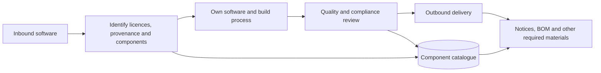
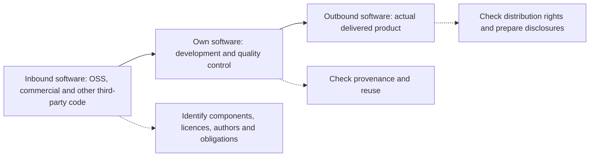
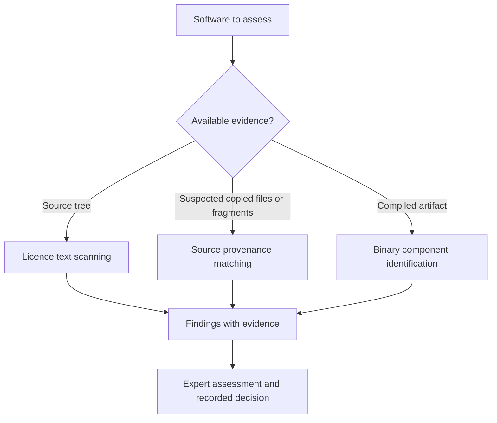
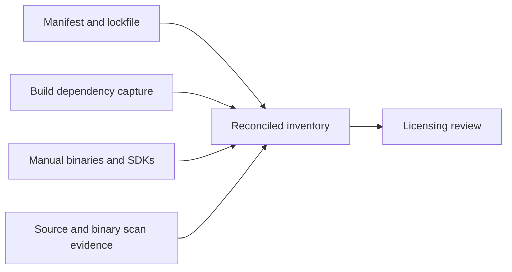
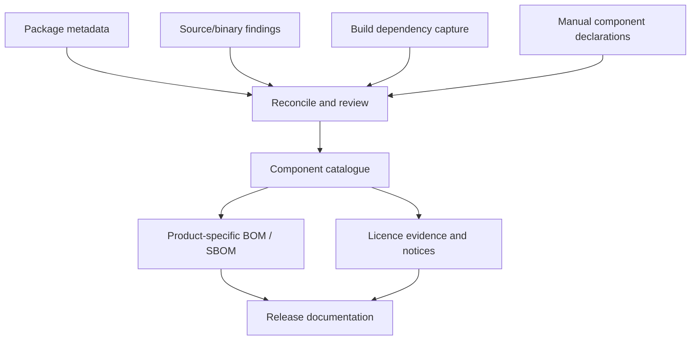
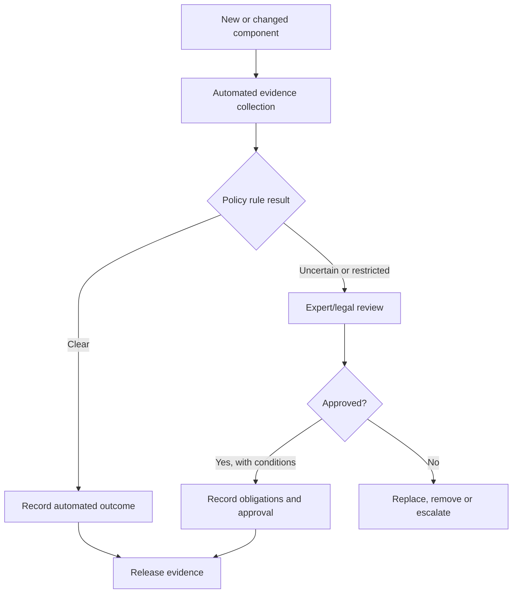
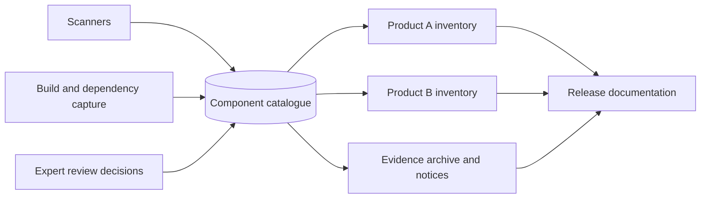

# Training Course Outline  
## Open Source Tools & Solutions for Open Source License Compliance

---

## Course Overview
- **Audience**
  - Software engineers and architects responsible for build and release
  - Legal and compliance professionals supporting product delivery
  - OSPO members defining governance and tooling
  - DevSecOps teams integrating compliance into pipelines
- **Level**
  - Intermediate (requires completion of LFC193 and LFC194)
  - Advanced extensions for scale, automation, and audits
- **Format**
  - Modular delivery (can be split across multiple sessions)
  - Combination of lecture, discussion, and hands-on exercises
- **Learning Outcomes**
  - Translate legal license obligations into technical requirements
  - Design and operate automated compliance workflows
  - Evaluate and apply open source compliance tooling
  - Generate and review compliance deliverables
  - Embed compliance into modern software delivery processes

---

## Required prerequisite training

Before starting this course, participants must complete both of the following Linux Foundation courses, in order:

1. [LFC193 – Introduction to Open Source License Compliance Management](https://training.linuxfoundation.org/training/introduction-to-open-source-license-compliance-management-lfc193/): foundational licensing, intellectual property, compliance concepts, code building and distribution, and structuring a compliance programme. Content also available from OpenChain under a CC0 license [here](https://github.com/OpenChain-Project/Reference-Material/tree/master/OpenChain-Training/en/Online-Training-Courses/LFC193%20Course%20Content).
2. [LFC194 – Implementing Open Source License Compliance Management](https://training.linuxfoundation.org/training/implementing-open-source-license-compliance-management-lfc194/): open source review, end-to-end compliance processes, common pitfalls and developer guidelines. ontent also available from OpenChain under a CC0 license [here](https://github.com/OpenChain-Project/Reference-Material/tree/master/OpenChain-Training/en/Online-Training-Courses/LFC194%20Course%20Content).

Both are listed as free, self-paced courses with 1–2 hours of material each. These are mandatory prerequisites for **this tooling course**.

### Scope of this follow-on course

This course assumes participants understand licensing obligations, review roles, compliance programme design and distribution processes. These subjects are recalled only where necessary to explain tool inputs, outputs, configuration, limitations or integration. The emphasis is on selecting, combining and operating tools that support an established compliance process. Participants needing a refresher should return to LFC193 or LFC194 rather than receive a repeat of those courses here.

---

## Source material and teaching approach

**(MY Note: kept in for now for transparancy, TODO: remove/revise later)**
This expanded course uses the supplied Markdown outline as its framework and draws its historical training content from:

- **Tooling-Overview.pdf** — *Covering OSS Compliance with Software Tools*, Software Compliance Academy, Dr. Catharina Maracke and Dr. Michael C. Jaeger (35 pages).
- **Tooling-Overview-Part 2.pdf** — *Covering OSS Compliance with Software Tools*, Software Compliance Academy, Dr. Catharina Maracke and Dr. Michael C. Jaeger, dated 12 June 2018 (33 pages).

Page references below identify the original PDF slide numbers. Teaching explanations, scenarios and Mermaid diagrams are newly written adaptations of the source material, not reproductions of the slides. Content from the pre-existing skeleton that the presentations do not address is labelled accordingly; current legal or regulatory requirements have **not** been independently verified.

### Overview diagram: End-to-end compliance process

**(MY Note: TODO: LFT will require good quality .png images)**

---

## Chapter 1: Open Source Compliance Concepts

### 1.1 What Is Open Source Compliance?

**Quick recap — LFC193 and LFC194:** Licence compliance concerns satisfying applicable licence obligations; governance defines responsibilities and processes, while security review addresses a different risk domain. Refer to the prerequisite courses for licensing fundamentals, risks and stakeholder responsibilities. Here, we focus on the evidence and workflows tools must support.

#### Teaching content: Define the process before choosing tools

The first principle of tooling-led compliance is **define the demand and process first; select the tool second**. Tools can collect evidence, analyse information, manage policies and produce reports, but they cannot independently determine whether a particular use or distribution is legally permissible. A human reviewer must resolve ambiguous findings and assess the business context. This is a recurring theme in the source presentations. [Source: *Tooling-Overview*, pp. 2–3, 33.]

The course uses a three-stage model:

* Inbound: identify what the organisation has obtained, including OSS embedded in commercial packages.
* Own: check that supposedly original development does not include unrecorded copied code, scripts, icons, CSS or examples.
* Outbound: determine **what is actually delivered** and satisfy applicable licence obligations for that delivery.

**Discussion:** Why is a scanner report not equivalent to a legal clearance decision? What evidence would a reviewer need beyond a licence name?

[Source: *Tooling-Overview*, pp. 4–9, 19–24.]

### 1.2 Key Compliance Artifacts

**Quick recap — LFC193/LFC194:** Applicable obligations determine which notices, licence texts and source provision mechanisms are required. This course concentrates on generating, validating and retaining the inventory, licensing evidence, notices and approval records.

#### Teaching content: Evidence and deliverables

A component inventory or bill of materials answers the fundamental supply-chain question: *what software is in the product?* The source presentation links this inventory to the ability to identify licences, authors and copyright statements, evaluate intellectual-property risks, and prepare distribution documentation. A release may need a list of licence texts and copyright notices, and in some cases a written source-code offer. The precise requirements depend on the actual licences and distribution arrangement. [Source: *Tooling-Overview*, pp. 23–24, 28.]

**Worked example:** A product combines an internally developed application, a third-party library and a commercial SDK. Its evidence pack should record the included components, versions where known, their provenance, licensing evidence, review decisions and the obligations applicable to the release. The commercial SDK must be checked too: third-party contractual restrictions are not limited to OSS. [Source: *Tooling-Overview*, pp. 9, 27.]

**(MY Note: TODO: change any Exercises to learning quiz questions when section content firmed up)**

**Exercise:** Sketch a release evidence pack and distinguish evidence collected automatically from evidence requiring human review.

### 1.3 Standards and Best Practices

**(MY Note: TODO: These would be examples mostly)**

- SPDX
  - License identifiers and expressions
  - Document structure and fields
- CycloneDX
  - Focus on supply chain transparency
- OpenChain ISO/IEC 5230
  - Organizational conformance requirements
- OpenSSF guidance
  - Integration of compliance with security practices

---

#### Teaching content: Standards versus tool outputs

The older training explicitly identifies **SPDX files** as a means of exchanging detected licensing information and discusses a BOM as the basis for software-supply-chain visibility. [Sources: *Tooling-Overview-Part 2*, p. 7; *Tooling-Overview*, p. 28.]

**Framework extension (not explained in the source slides):** SPDX, CycloneDX, OpenChain ISO/IEC 5230 and OpenSSF are retained from the supplied course skeleton. Explain their different purposes during delivery; do not present a scanner-generated SPDX document as proof that all licensing decisions have been completed.

## Chapter 2: Open Source License Scanning & Discovery Tools

### 2.1 Source Code Scanning
- What scanners analyze
  - File headers
  - Embedded license texts
  - Copyright statements
- Detection methodologies
  - Exact matching
  - Heuristic and fuzzy matching
- Accuracy considerations
  - False positives
  - False negatives
- Limitations
  - Generated code
  - Minified or binary artifacts
**(MY Note: TODO: snippet scanning??)**

#### Teaching content: Distinguish licence scanning from provenance scanning

**Licence scanners** inspect source content for licence texts, keywords, phrases, copyright notices, author statements and acknowledgements. Techniques described in the slides include regular expressions, text comparison and phrase collections, supported by a database of known licence texts. They can produce package-level summaries, but the identification depends on the completeness of the underlying evidence and may require expert interpretation. [Source: *Tooling-Overview-Part 2*, pp. 4–8.]

**Source-code provenance scanners** address a different question: *did supposedly original code originate from published material?* They compare files or fragments with databases of published content; fingerprints or hashes can accelerate matching. Their scope may include icons, images, style files, XML schemas, documentation and code copied from tutorials. A match is evidence for investigation, not by itself a determination of infringement or licence applicability. [Source: *Tooling-Overview-Part 2*, pp. 16–20.]

**Binary scanners** attempt to identify packages and sometimes versions in compiled artifacts. The slides describe characteristic strings, filenames, method names and other recognisable elements. This is heuristic identification: different compilation methods and small variations can frustrate matching. Reproducible builds can help comparison. [Source: *Tooling-Overview-Part 2*, pp. 10–14.]

**Teaching caution:** The slides distinguish tool functions, not guarantees of complete detection. Unmatched code, incorrect metadata, and ambiguous licence statements require further investigation.

### 2.2 Tool Categories
- Source code scanners  
- Package and dependency analyzers  
- Metadata and curation services  
- License identification libraries  

#### Teaching content: Tool selection matrix

| Category | Principal question | Input | Typical output | Limitation |
|---|---|---|---|---|
| Licence scanner | What licensing statements appear? | Source files and licence texts | Candidate licences, notices, authors | Statements may be incomplete or inconsistent |
| Source provenance scanner | Has this code or content appeared elsewhere? | Source files or fingerprints | Candidate origins and matches | Match relevance requires expert review |
| Binary scanner | Which packages may be in this artifact? | Executables and libraries | Candidate packages/versions | Heuristic and technology-dependent |
| DevOps integration | What was used to build this release? | Build/dependency metadata | Build inventory and reports | Custom integration often needed |
| Component catalogue | What has already been reviewed? | Reviewed component records | Reusable analysis and product BOMs | Depends on accurate updates and mappings |

This categorisation and the associated limitations are drawn from *Tooling-Overview-Part 2*, pp. 2–32. Named software examples remain in Appendix A rather than being inserted into the main teaching chapters.

### 2.3 Hands-On Lab

**(MY Note: TODO: change to worked example?)**

- Selecting a representative project  
- Running an initial scan  
- Reviewing detected licenses and confidence levels  
- Identifying:
  - Unknown licenses  
  - Multiple licenses per component  
- Documenting findings for downstream review  

---

#### Guided lab: Triaging ambiguous evidence

1. Examine a sample project containing a top-level licence, a file with a different header and a file referring to an external `COPYING` document.
2. Record the file-level evidence rather than assuming that the project-level licence applies uniformly.
3. Mark unknown or conflicting findings as **review required**, and record the source location and proposed next step.
4. Compare a licence scan with a provenance scan and explain why they answer different questions.

**Expected deliverable:** A findings register with columns for file/component, evidence, candidate licence, confidence or uncertainty, reviewer and resolution. The presentation examples include references to separate licence files, copyright statements in other files and web pages. [Source: *Tooling-Overview*, pp. 13–17.]

## Chapter 3: Dependency & Package Analysis

### 3.1 Dependency Management Basics
- How dependencies are introduced  
  - Direct dependencies  
  - Transitive dependencies  
- Dependency resolution  
  - Version constraints  
  - Lockfiles  
- Risks introduced by transitive dependencies  
- Language- and ecosystem-specific considerations  

#### Teaching content: Declared, resolved and manually introduced software

Modern projects declare imports, libraries and dependencies in build tooling; this metadata can reveal some inbound components. However, the slides emphasise that not all dependencies are declared: teams also add binaries, commercial packages or other **manual dependencies**. Commercial software can itself contain OSS. Consequently, a dependency graph is a starting point rather than a complete record of the shipped product. [Source: *Tooling-Overview*, pp. 9–10.]

**Example:** A build manifest lists two direct dependencies. One resolves further transitive dependencies; a separately downloaded SDK is copied into the build directory. Ask learners which sources of evidence reveal each item and what may be missing from a manifest-only scan.

### 3.2 Dependency Analysis Approaches
- Manifest-based analysis  
  - Declared dependencies only  
- Lockfile analysis  
  - Resolved dependency trees  
- Build-system introspection  
  - Actual artifacts used in builds  
- Pros and cons of each approach  

#### Teaching content: Triangulate the evidence

The source presentations describe build-system integration as a way to capture dependencies during compilation and create a BOM. They also recognise that the exact implementation depends on technology, local tooling and mixed-language projects. Existing build metadata may include licensing information, but heterogeneous licensing can still require checking the actual source files. [Source: *Tooling-Overview-Part 2*, pp. 22–25.]

**Review prompt:** What would cause a declared dependency not to appear in the delivered artifact, or an undeclared component to appear in it?

### 3.3 License Expression Handling

**Prerequisite link — LFC193:** Licence fundamentals are assumed; retain SPDX expression handling because it is directly relevant to machine-readable scanner results and policy rules.
- SPDX license identifiers  
- Compound expressions  
  - AND / OR semantics  
- License exceptions  
- Dual-licensed components  
- Practical compatibility analysis scenarios  

---

#### Teaching content: Licence ambiguity and heterogeneous projects

The slides explain that an OSS project can contain code from multiple origins and under multiple licences; its main licence need not cover every file. Examples include licence references to separate files or websites and the ambiguous statement **“Licensed under BSD”**. Such findings require a documented interpretation rather than silent normalization. The slides also raise potential GPL/EPL compatibility concerns; whether a conflict exists depends on the relevant versions, combination and distribution facts. [Source: *Tooling-Overview*, pp. 12–15, 25.]

**Worked exercise:** Compare `MIT OR Apache-2.0` with `MIT AND Apache-2.0` as illustrative SPDX expressions (an extension from the course skeleton, not a worked example in the slides). Identify which choices require legal review and what evidence should be retained.

## Chapter 4: Software Bill of Materials (SBOM)

### 4.1 Why SBOMs Matter
- Regulatory and policy drivers  
- Customer and partner requirements  
- Internal benefits  
  - Inventory visibility  
  - Faster compliance reviews  
- SBOMs as living documents vs point-in-time artifacts  

#### Teaching content: BOM as a bridge from discovery to delivery

The first presentation argues that knowing the contents of the delivery is foundational to licence compliance, product documentation and broader supply-chain understanding. The second describes build integration and component catalogues as mechanisms for generating or maintaining a BOM. [Sources: *Tooling-Overview*, pp. 23, 28; *Tooling-Overview-Part 2*, pp. 22, 28–32.]

**Historical-source note:** Regulatory references in the 2018 presentation are historical examples, not a current regulatory assessment. The modern regulatory topics retained in the skeleton need separate up-to-date legal research before teaching them as current requirements.

### 4.2 SBOM Formats and Tradeoffs
- SPDX  
  - Compliance and legal focus  
- CycloneDX  
  - Supply chain and security focus  
- Serialization formats  
  - Human-readable vs machine-readable  
- Interoperability considerations  

#### Teaching content: What the source supports

The older slides specifically mention exchanging licence information via **SPDX files** and retaining SPDX files in a component catalogue. They do **not** compare modern SPDX and CycloneDX schema versions or establish format-specific regulatory obligations. Those comparison topics are retained as syllabus items for later supplementation. [Source: *Tooling-Overview-Part 2*, pp. 7, 30.]

### 4.3 SBOM Generation Approaches
- Source-based generation  
- Binary-based generation  
- Container image analysis  
- Build-time generation  
  - Advantages for accuracy  
- Post-build generation  
  - Advantages for coverage  

#### Teaching content: Build a reconciled SBOM

A useful inventory combines package-manager records, build capture, source evidence, binary findings and manual component declarations. The component catalogue stores reviewed metadata and maps components to projects or products, allowing prior analysis to be reused. Scanner findings can feed the catalogue, and the catalogue can support product-specific documentation. [Source: *Tooling-Overview-Part 2*, pp. 28–32.]

### 4.4 Hands-On Lab
- Generate an SBOM for a sample artifact  
- Review required vs optional fields  
- Identify missing or ambiguous data  
- Connect SBOM entries to license obligations  

---

#### Guided lab: Coverage and completeness

Create an SBOM or equivalent component inventory from a sample project. Add a deliberately omitted manually supplied binary and compare the inventory before and after reconciliation. For each entry, record the evidence source, known licence data and whether further review is required. **Deliverable:** a revised inventory and a short gap report. The manual-dependency and binary-discovery scenarios come from *Tooling-Overview*, pp. 9–10, 18.

## Chapter 5: Policy, Governance & Automation

### 5.1 Defining Open Source Policies

**Quick recap — LFC194:** Assume an established policy, review process and escalation route. Identify the policy inputs that must be represented in tooling: licence categories, intended use, exceptions, approval owners and release conditions. Do not repeat policy development or contribution guidelines.

#### Teaching content: Policy is a business decision

The slides emphasise that licence obligations must fit the organisation's business goals and that distribution rights must be established for all third-party software, including commercial packages. A technically detectable licence may still be incompatible with the intended delivery or commercial model. [Source: *Tooling-Overview*, pp. 25–27.]

**Discussion scenario:** A company plans to distribute a proprietary product containing OSS with potentially conflicting obligations. Identify the questions for legal, engineering and product management before approving release.

### 5.2 Automated Policy Enforcement
- Translating policy into rules  
- Policy-as-code concepts  
- Evaluation timing  
  - Pre-commit  
  - CI  
  - Release gates  
- Reporting and approval workflows  

#### Teaching content: Automation boundaries

A policy engine can flag predefined conditions, route findings for review and preserve approvals. The source material's central caution remains: a tool supplies data and supports workflow, while a human makes context-dependent decisions. Once a baseline has been checked, the slides describe a **differential approach** in which newly introduced dependencies receive additional attention. [Sources: *Tooling-Overview*, pp. 2, 33; *Tooling-Overview-Part 2*, p. 25.]

### 5.3 CI/CD Integration
- Where compliance fits in pipelines  
- Incremental vs full scans  
- Handling policy violations  
  - Fail, warn, or escalate  
- Developer feedback and usability considerations  

---

#### Teaching content: Integrating into the build

The second presentation identifies four operational benefits: capture dependencies while building, combine build evidence with scanning, generate BOM data and reduce manual reporting during short release cycles. It also warns that integration depends on the languages and local build architecture and therefore requires customization. [Source: *Tooling-Overview-Part 2*, pp. 22–26.]

**Practical exercise:** Design a CI workflow with a build inventory step, a scanning step, a review queue for unresolved findings, a component-catalogue update and a release-documentation step. Specify which checks can fail automatically and which require human sign-off.

## Chapter 6: Handling Compliance Issues

### 6.1 Common Compliance Problems
- Missing or incomplete license information  
- Conflicting licenses in dependency trees  
- Copyleft obligations misunderstood or misapplied  
- Custom or non-standard licenses  

#### Teaching content: Failure patterns from the source material

Common problems include multiple licences inside one project, licence text stored in a different file, references to external websites, difficult copyright statements, undeclared copied snippets, and opaque binaries. The first presentation provides examples of each. It also cautions that commercial end-user licences are less standardized than typical OSS licences. [Source: *Tooling-Overview*, pp. 11–18, 20–21.]

**Scenario:** A source file points to a web page for its licence conditions, but the page later changes. Ask what evidence should have been archived and how to record the uncertainty. [Source: *Tooling-Overview*, p. 26.]

### 6.2 Remediation Strategies

**Quick recap — LFC194:** Remediation can involve technical, legal or documentation changes. Focus here on tracking findings, preserving evidence and re-running checks after remediation.

#### Teaching content: From finding to remediation

For a detected issue, determine the exact component and usage, verify the licence evidence, assess distribution rights and document the outcome. Remediation might involve replacing a component, changing how it is used, obtaining permission, or correcting notices and disclosure material. These remediation options extend the original course skeleton; the slides primarily establish the underlying identification, compatibility and documentation problems. [Source basis: *Tooling-Overview*, pp. 23–27.]

### 6.3 Working with Legal & Engineering

**Quick recap — LFC194:** Review responsibilities and escalation processes are assumed knowledge. Focus on the fields, evidence and workflow state needed for tool-supported hand-offs and audit trails.

#### Teaching content: Review hand-offs

A useful review record contains the detected finding, file or package location, supporting evidence, product context, decision owner, reasoning and final disposition. Expert review is particularly important where matches are uncertain or licence statements are ambiguous. [Sources: *Tooling-Overview*, pp. 2, 25; *Tooling-Overview-Part 2*, pp. 7, 19.]

**Group activity:** Assign an engineer, compliance analyst and legal reviewer to resolve an ambiguous licence statement. Each role should explain the evidence it needs and the decision it can responsibly make.

## Chapter 7: Open Source Compliance at Scale

### 7.1 Open Source Program Offices (OSPOs)

**Quick recap — LFC193/LFC194:** Compliance programme structure and review responsibilities are prerequisite material. In this course, examine shared tooling ownership, scan coverage, review turnaround and reuse of component analyses.

#### Teaching content: Shared services and repeatable reviews

The source presentations do not describe an OSPO organizational model in detail. They do, however, establish the operational rationale for shared tooling: common evidence, consistent review and reuse of earlier component analyses. Use these ideas to discuss centralized and federated ownership models without attributing a particular OSPO design to the slides. [Source: *Tooling-Overview-Part 2*, pp. 28–31.]

### 7.2 Compliance for Products & Distributions

**Prerequisite link — LFC193/LFC194:** Recall distribution and end-to-end review concepts only as needed to configure artifact discovery and release evidence generation.
- Product-specific challenges  
- Embedded and firmware constraints  
- Containers and cloud-native delivery  
- Long-term support and update obligations  

#### Teaching content: Outbound obligations and third-party rights

The slides identify three release concerns: distributing OSS with the required notices or source offers; making licence checks part of quality management; and confirming distribution rights where licences may conflict. They also stress that commercial third-party agreements can contain time, volume, branding and other distribution restrictions. [Source: *Tooling-Overview*, pp. 23–27.]

**Release checklist exercise:** Verify component inventory, licences and copyright statements, licence compatibility review, notice files, any applicable source-code offer, commercial contractual rights and archived evidence. Treat every obligation as licence- and context-dependent rather than universal.

### 7.3 Case Studies
- Typical failure patterns  
- Root cause analysis  
- Preventative controls  
- Lessons learned for scaling organizations  

---

### 7.4 Component Catalogues as a Scaling Mechanism

#### Teaching content: Component catalogue architecture

A component catalogue centrally stores reviewed component information and maps component usage to products and projects. The second presentation describes a database or web portal that can archive OSS distributions, source code, analysis reports and SPDX files, and generate product documentation. It can receive data from scanners and build systems and may also support vulnerability and export-classification use cases. [Source: *Tooling-Overview-Part 2*, pp. 28–32.]

**Discussion:** Which metadata should be global to a component, and which decisions must be specific to the way a particular product uses or distributes it?

## Chapter 8: Emerging Trends & Future Directions
- Increasing regulation and standardization  
- SBOMs as compliance and security primitives  
- AI-generated code and license provenance  
- Model weights, datasets, and open source obligations  
- Convergence of compliance, security, and supply-chain risk  

---

#### Teaching content: Historical foundation and modern extensions

The presentations were prepared in 2018 and discuss the durable principles of software inventory, licence evidence, build automation, component reuse and supply-chain visibility. They do **not** substantively address AI-generated code, model-weight licensing, modern regulatory changes or current SBOM schemas. Those topics remain in this course because they were present in the supplied skeleton, but require separately researched, current teaching material before delivery. [Sources: *Tooling-Overview*, p. 33; *Tooling-Overview-Part 2*, pp. 22–32.]

## Capstone Exercise (Optional)
- Define compliance requirements for a sample product  
- Execute an end-to-end workflow  
- Produce:
  - Scan results  
  - SBOM  
  - Notices  
  - Policy evaluation report  
- Group review and discussion  

---

### Capstone scenario: Mixed-source product release

A team is preparing to ship a product containing an internally developed application, dependencies resolved by a build tool, a manually added binary SDK and copied example code. Learners must:

1. Build an inbound inventory and identify undeclared components.
2. Select the appropriate scanner for each type of evidence.
3. Record file-level licence statements, copyright notices and provenance concerns.
4. Escalate an ambiguous licence and a possible incompatibility.
5. Create a component catalogue entry, product BOM/SBOM and notice pack.
6. Recommend release, conditional release or remediation, with documented reasoning.

This scenario combines the source presentations' inbound/own/outbound model, scanner distinctions, manual dependencies, component catalogue and distribution-documentation requirements. [Sources: *Tooling-Overview*, pp. 9–10, 20–28; *Tooling-Overview-Part 2*, pp. 4–32.]

## Course Materials & Resources
- Required prerequisite courses: LFC193 and LFC194 (linked in the course overview).
- Standards and specification references  
- Sample compliance policies  
- Example artifacts and templates  
- Checklists for audits and releases  

---

# Appendix A: Example Open Source Tools and Implementations

### A.1 License Detection & Source Scanning
- ScanCode Toolkit  
- FOSSology  
- Licensee (GitHub)  

### A.2 Dependency & Package Analysis
- OSS Review Toolkit (ORT)  
- Syft  
- Eclipse Steady  
- REUSE Tool  

### A.3 SBOM Generation
- Syft  
- ORT  
- ScanCode  
- CycloneDX CLI  

### A.4 Policy Evaluation & Automation
- ORT Evaluator  
- Custom policy-as-code frameworks  

### A.5 Metadata & Curation
- ClearlyDefined  

---

## Source references and attribution

The training presentations are attributed to **Dr. Catharina Maracke and Dr. Michael C. Jaeger, Software Compliance Academy**. The second presentation is dated **12 June 2018**. The explanations in this document are original paraphrases and instructional adaptations. The source PDFs should be retained alongside this course for reference; this file does not reproduce their complete slide text or graphics.

**Editorial note:** Examples and claims concerning regulations, current tools, licence versions and AI should be reviewed and updated before delivery. The presentations are historical training sources, not a substitute for current legal advice.
